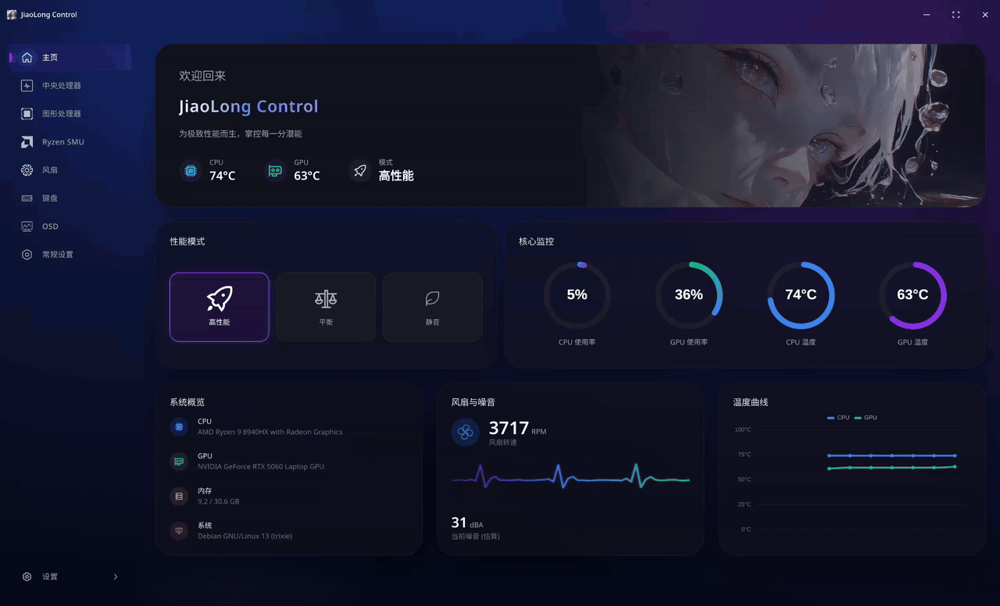

# 蛟龙 16 Pro 控制中心 · Debian / Linux 版



把 Windows 上的 **JiaoLongControl** 搬到 Linux：性能模式、风扇、键盘灯、触摸板、温度功耗曲线，
全都收进一个和原版一样的面板里。硬件访问不需要自己编译内核模块，装个 `.deb` 就能用。

> 这是 [GaoXanSheng/JiaoLongControl](https://github.com/GaoXanSheng/JiaoLongControl) 的社区 Linux 移植。
> 上游是 Windows 专用（WPF + WebView2 + 内核驱动），本项目保留它的 Vue 界面，重写了硬件层与外壳。

## 支持机型

| 机型 | 状态 |
|---|---|
| MECHREVO 蛟龙 16 Pro（X6DR55xx-B2，Ryzen 9 8940HX + RTX 5060 Laptop） | ✅ 开发机，逐项实测 |
| 同代 Uniwill / Tongfang 模具（EC 接口为 `INOU0000`） | ⚠️ 理论可用，需要自行确认寄存器 |
| 其它品牌 / 老机型 | ❌ 不保证，可能装得上但控制无效 |

不确定自己的机器是否同一套接口？跑一下：

```bash
ls /sys/bus/acpi/devices | grep -i inou   # 有 INOU0000 基本就是同一套 EC 协议
ls /proc/acpi/call                        # 存在说明 acpi_call 可用
```

系统要求：Debian 13（trixie）或更新的 AMD64 发行版，GNOME / KDE 等 X11 或 Wayland 桌面均可
（OSD 依赖 XWayland）。

## 安装

从 [Releases](https://github.com/kiluahh/JiaolongControl-debian/releases) 下载 `.deb`，然后：

```bash
sudo apt install ./jiaolongcontrol_0.1.1_amd64.deb
```

安装脚本会自动：安装依赖、创建 `jlc` 组并把当前桌面用户加进去、启用并启动后台硬件服务 `jlc-daemon`。

**装完请注销并重新登录一次**（用户组变更需要新会话才生效），然后在应用菜单里搜索
「蛟龙控制中心 / JiaoLong Control」打开即可。

依赖说明：

- `acpi-call-dkms`：EC 读写通道，Debian 源里有，作为推荐依赖自动安装。
- `nodejs`：后台服务运行环境，Debian 源里有，自动安装。
- `ryzen_smu`：**可选**，只有 CPU 功耗 / 超频（Ryzen SMU 页）需要。Debian 源没有这个模块，
  不装也能正常使用除该页以外的全部功能；需要时按
  [ryzen_smu](https://github.com/leogx9r/ryzen_smu) 的说明用 DKMS 编译。

## 能做什么

| 功能 | 说明 |
|---|---|
| 性能模式 | 高性能 / 平衡 / 静音一键切换，与机身指示灯和风扇同步（实测） |
| 风扇 | 实时转速（CPU/GPU）；**自动 / 全速**两档。本机 EC 不接受按转速手动控制，见下方说明 |
| 键盘背光 | 档位 0–4 开关、单色 RGB、呼吸灯 |
| 触摸板 | 一键开关（写 GNOME 设置后回读校验） |
| 系统监控 | CPU 频率/温度/占用、GPU 占用/温度/显存、风扇转速、实时曲线、内存与系统信息 |
| CPU 功耗与超频 | TDP、EDC、温度墙、Curve Optimizer（全核 / 分核）、整包功耗显示（RAPL 实测） |
| GPU 频率 | 锁定核心 / 显存最低频率（`nvidia-smi -lgc/-lmc`） |
| 屏幕 OSD | 性能模式、风扇、键盘背光、触摸板变化时，在屏幕角落滑出提示条 |
| 开机自动应用 | 勾选后每次开机自动套用性能模式、CPU 参数与键盘背光 |
| 托盘常驻 | 关窗口不退出，托盘图标可重新打开面板 |

## 屏幕 OSD


系统自己不会提示的那几类状态变化，由面板补上：从屏幕边缘水平滑入，停留一会儿后原路滑出。
可以在 OSD 设置页里选四个角、调出入场时间、停留时长、不透明度和缩放。

音量**没有**做 OSD —— GNOME 已经有原生音量提示，重复显示反而碍事。

## 已知限制

有些 Windows 上的功能在 Linux 上没有可行接口，本项目选择如实说明、不提供假开关：

| 功能 | 原因 |
|---|---|
| 风扇曲线 / 手动转速 | 本机 EC 不接受按转速或占空比写入，只有全速位有效（多路写入实测转速不变，证据在 `probe/`） |
| GPU 曲线超频 | Linux 没有 NVAPI 的 VF 曲线接口 |
| Caps Lock / Num Lock 模拟切换 | 需要 uinput 注入虚拟键盘，评估后不做；面板改为提示按物理键 |
| Logo 灯 | 寄存器未确认 |
| 逐键 RGB | 需要 ITE HID 设备，本机没有 |

## 常见问题

**提示「无法访问 jlc-daemon：当前用户不在 jlc 组」？**

这是权限问题，不是服务没启动。安装时已经把你加入了 `jlc` 组，但它要**新登录会话**才生效：
注销再重新登录一次即可，也可以临时在当前终端运行 `newgrp jlc`，再从该终端启动面板。

```bash
groups | grep jlc     # 重新登录后这里应该能看到 jlc
```

**提示「jlc-daemon 未运行」/ 数据全是 0？**

```bash
systemctl status jlc-daemon     # 后台服务是否在跑
ls /proc/acpi/call              # acpi_call 是否加载
journalctl -u jlc-daemon -e     # 看具体报错
```

**风扇页只有「自动 / 全速」？** 正常，见上面的已知限制。

**托盘图标不显示？** GNOME 需要安装 AppIndicator 扩展（`gnome-shell-extension-appindicator`）。

**怎么卸载？**

```bash
sudo apt purge jiaolongcontrol
```

会同时清理 `/opt/jiaolongcontrol`、`/etc/jlc`、`jlc` 组和 systemd 服务。

## 从源码运行

```bash
# 前置：node ≥ 20、acpi-call-dkms（ryzen_smu 可选）
npm --prefix client install && npm --prefix client run build
npm --prefix app install

./run.sh          # 起后台 daemon（/tmp/jlc.sock）+ 打开界面，会提示一次 sudo 密码
sudo npm test     # 单元测试
```

自己打 `.deb`：

```bash
./packaging/build-deb.sh     # 产物在 dist/
```

## 相关文档

- [docs/technical.md](docs/technical.md)：架构、EC 地址表、为什么重写后端、调试与探针脚本
- [docs/upstream-linux-merge.md](docs/upstream-linux-merge.md)：与上游 Linux 分支的对比和合并计划

## 致谢与许可

- 上游：[GaoXanSheng/JiaoLongControl](https://github.com/GaoXanSheng/JiaoLongControl)（MIT），界面与协议来自这里。
- 键盘背光 / RGB 协议参考了 TUXEDO 的 GPL 驱动，并已在本机复核。
- 本项目同样以 MIT 许可发布，见 [LICENSE](LICENSE)。
